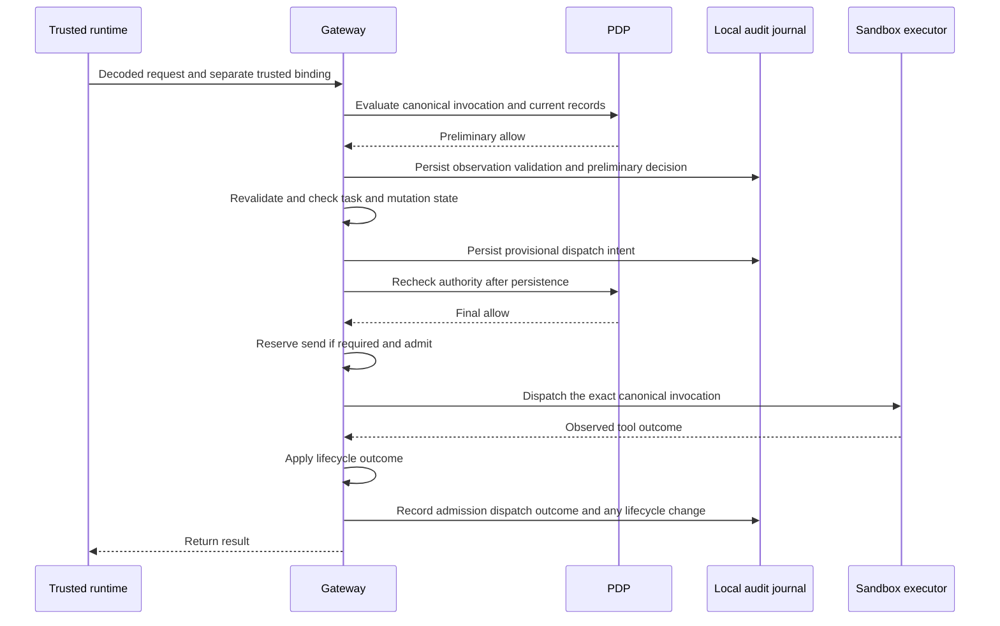
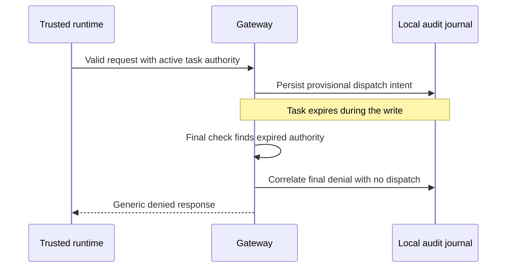

# Phase 5 authorisation gateway

`Gateway.handle(request, run, context=None)` is the entry point for the controlled tool-use path. The application supplies the registered `RunBinding` and any `RuntimeExecutionContext` separately. One gateway instance has a fixed trusted policy mode and a fixed local journal and sandbox. The validator detaches one canonical invocation. The PDP evaluates it against trusted records, and the gateway as PEP checks final admission before passing that same object to the private executor. The executor calls an explicitly registered sandbox handler. [Phase 2 system design](system-design.md) · [Phase 4 identity and delegation](identity-delegation-design.md)

## Request and registry

```json
{"tool":"read_document","arguments":{"resource_id":"meeting_notes.txt"}}
```

The boundary accepts already decoded built-in dictionaries. Tool IDs, argument names and argument values must be strings. The registry derives the action, accepted resource kind and handler. It supplies detached JSON-schema-shaped descriptions through `tool_schemas()`. The same seven schemas are supplied for all modes. Resource IDs are checked against the trusted catalogue and remain logical keys. The registry reuses the sandbox length limits and simulator routes. Both routes are valid structurally. Text limits count Python string code points, with a non-empty query and inclusive maxima. [Sandbox tool contracts](sandbox-design.md#trusted-tool-contracts)

| Registered tool | Action | Kind | Required arguments |
| --- | --- | --- | --- |
| `read_document` | `read` | Document | `resource_id` |
| `search_documents` | `search` | Document | `resource_id`, `query` |
| `create_document` | `create` | Document | `resource_id`, `content` |
| `edit_document` | `edit` | Document | `resource_id`, `content` |
| `delete_document` | `delete` | Document | `resource_id` |
| `read_email` | `read` | Inbox | `resource_id` |
| `send_simulated_email` | `send` | Outbox | `resource_id`, `destination`, `subject`, `body` |

Unknown fields, including any claimed identity, authority, action or mode, cause rejection. Canonical invocations use a frozen record and a tuple of validated string arguments, so changes to the input dictionary after validation cannot change the operation. Raw JSON parsing, duplicate key rejection at transport and transport size limits are responsibilities of the future adapter. The executor owns state preconditions such as document existence and occupancy.

## Shared checks and comparison policies

Every mode checks registration of the exact shared run, a valid session, and current enabled human and agent records. The immutable registry, structural validation, executor and audit rules are shared. Record versions are recorded for traceability. The PDP returns a decision and stable reason code with its policy mode, configuration version `phase5-v1` and available security-record versions.

| Mode | Decision rules |
| --- | --- |
| A — Broad static permissions | Checks membership in the fixed supported action–resource set. Includes all five document actions on each slot, inbox read and outbox send to either registered route |
| B — Static tool allowlist | Document Agent may use document read, search, create and delete. Email Agent may use inbox read and simulated send. Each allowed tool accepts any structurally valid target and arguments |
| C — Identity and task scoped | Requires a runtime-owned active context of the exact shared run. Checks current identity and delegation versions, lifecycle, expiry, and current grant coverage. Requires the exact action–resource pair in the human, agent and task grants. Search also requires read on the same document in every layer. Send requires the destination in every layer's explicit route set |

A and B use no principal grant intersection or task lifecycle restriction. They retain the shared binding after delegation expiry, completion and revocation. Session invalidation or disabled principals prevent execution in every mode. The read and search grants of T6 apply to the approved document. The `agenda` query remains an evaluation completion predicate. [Approved baseline design](experimental-design.md#comparison-systems)

## Final admission and execution





The supported runtime is single-threaded and non-reentrant, with one gateway instance controlling a sandbox and trusted code ordering authority changes on the owning thread. The gateway rejects entry from another thread or during an existing call. An injected audit sink can simulate a trusted state change during persistence. The gateway evaluates current authority before recording intent and again afterward, then reserves any applicable send and invokes the handler without an intervening audit write. The admission point is the successful final check and applicable reservation immediately before invocation. A revocation ordered before that point prevents dispatch. A committed effect remains visible after revocation. Clocks are trusted and side-effect-free, and the executor is a trusted component. This ordering does not provide synchronisation for concurrent writes through Phase 4 stores or direct sandbox calls.

`GatewayResult` separates the final authorisation verdict, dispatch, executor outcome, tool data, lifecycle and write failures. Trusted sandbox precondition errors are failed executions with no side effect. The gateway marks a resource before invoking a mutation and clears the mark only once the outcome is known and lifecycle handling has run. Unexpected handler exceptions leave the affected resource quarantined for the gateway's lifetime. Resolve uncertainty through trusted inspection before starting a fresh isolated runtime or trial. There is no automatic retry or rollback. A process interruption can leave a provisional intent without an outcome, which is insufficient evidence of execution or failure.

For C, successful designated create, send or delete closes T3, T4 or T5 respectively. T4 holds a per-delegation reservation across dispatch. Known no-effect failure releases it. A successful operation consumes authority before recording post-dispatch audit events. Authority stays unusable if completion records `EXPIRED` at the boundary or if completion bookkeeping fails. An uncertain send quarantines the outbox; a later send on the same gateway cannot append again. The shared sandbox retains its normal repeat-send semantics for A and B.

## Audit and timing

`JsonlAudit` appends a JSON line at the trusted configured path, flushes Python's buffer and calls `os.fsync` before returning. An attempt, validation, preliminary verdict and provisional dispatch intent are written before an operation can be dispatched. A malformed call records the validation failure and a final denial. An intent establishes that a dispatch was considered, while `admission`, `dispatch` and `outcome` events record what happened. For a successful admission these events are written after the handler returns. The journal adds a `lifecycle` event when relevant. Missing dispatch or outcome records are inconclusive. Each gateway namespaces its request IDs with an opaque value and orders them with a counter.

The journal records timestamps, trusted identifiers from registered bindings, mode and policy version, applicable record versions and event-specific reasons. Only canonical tool, action, resource and registered destination values are copied from validated requests. Registered destinations rejected by policy can still be logged. Malformed values are represented by safe validation statuses and omitted fields. Proofs, bearer tokens, document text, prompts, queries, subjects, bodies and exception messages stay out of the journal.

Phase 8 stamps audit schema version 1 and validates the field allowlist before persistence. The bounded reader compares journal rows with independently captured attempts and trusted results. [Audit schema and completeness rules](audit-security-design.md)

A failed required pre-dispatch write denies entry, and the gateway attempts to record the denial. `failed_audit_events` identifies unconfirmed writes. A failed post-dispatch write leaves the actual execution outcome and lifecycle effect intact. The append and flush protocol provides per-event persistence confirmation through the OS. It provides no atomic transaction spanning the journal and sandbox, recovery replay or tamper protection. Trusted callers keep the destination in a controlled directory.

| Measure | Monotonic interval in nanoseconds |
| --- | --- |
| Policy decision | Receipt to validation rejection or first policy verdict |
| Authorisation enforcement | Receipt to final admission or denial, including pre-dispatch persistence and all subsequent enforcement checks |
| Audit persistence | Submission of an individual event to its return or failure. Later events carry prior write timings and the trusted result includes all write timings |
| Executor | Handler invocation through return or exception |
| Gateway overhead | Receipt to structured result readiness, less executor time |

Audit times that gate dispatch are already included in enforcement time. Measurements contain no LLM inference or reported benchmark results. [Experimental timing definitions](experimental-design.md#latency-measurement-boundaries)

## Responses, tests and Phase 6 integration

`GatewayResult.model_response()` returns a generic `denied` or `error` status without trusted reason codes, resource state or stack traces. A successful read or search returns the corresponding synthetic data, which remains untrusted content. Successful simulated sends return only the message identifier in this projection. The trusted result retains the separate execution and audit statuses for local testing and evaluation. Phase 6 can expose the shared schemas and a thin wrapper that binds the registered run and context before invoking the gateway and returns only the model-facing projection.

Tests exercise all seven schemas, independent A/B/C expectations, all six legitimate task contracts, object identity across policy and dispatch, exact expiry and state changes around audit persistence, safe logs, failure before and after dispatch and task completion. The original Phase 1 demonstration and trusted sandbox entry points remain separate. Complete mediation applies to the controlled tool-call path. The project assumes trusted Python code and the local synthetic environment. OS sandboxing, arbitrary-code-execution resistance, production identity infrastructure and model integration remain outside Phase 5. [Development roadmap](roadmap.md)
