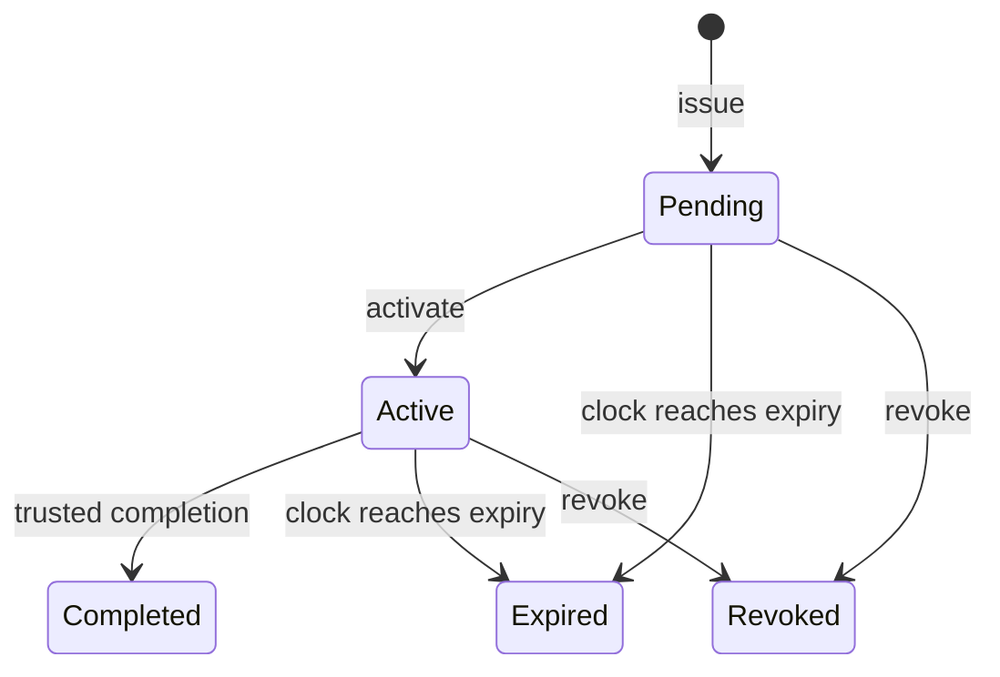

# Phase 4 identity and delegation design

Phase 4 implements the trusted control path that provisions synthetic identities, verifies sessions, assigns agents and binds task authority. The [Phase 2 access-control matrices](access-control.md) define the fixtures. The [Phase 3 sandbox](sandbox-design.md) supplies the shared resource catalogue and simulator routes. The two components remain independently callable by trusted application code. Tool admission and dispatch coordination belong to Phase 5.

## Identities and grants

`IdentityStore` holds immutable `Principal` records in separate human and agent namespaces. The default human records are `alice` (Employee), `bob` (Manager) and `charlie` (Administrator). The agent records are `document-agent` (Document Agent) and `email-agent` (Email Agent). Each record has a descriptive label, explicit grants, enabled status and a version starting at 1. Lookups reject unknown identifiers and can require an expected version. Trusted grant replacement and disabling create new versions. The role labels and sandbox metadata confer no implicit grants.

`Grant` reuses the existing `Permission(action, resource_id)` pair and adds a typed destination constraint. All six `Action` values are available. The Phase 1 `User`, `AgentIdentity`, `TaskDelegation`, `ExecutionContext` and decision function keep their proof-of-concept meaning. The runtime uses `Principal`, `RunBinding`, `DelegationRecord` and `RuntimeExecutionContext` for its richer records.

Grant construction validates the exact pair against the sandbox catalogue. Document slots accept read, search, create, edit and delete. The inbox accepts read, and the outbox accepts send. Every send grant has an explicit non-empty `frozenset` of registered routes. Other actions omit the constraint. A grant collection has at most one entry per pair. The store and manager reject mutable grant collections and ambiguous duplicate route constraints.

The human and agent fixtures match the approved matrices. Alice and the Email Agent each have both registered outbox routes, and T4 has team only. An issued grant must be covered by the trusted task template and by both current principals. Coverage requires the same pair and, for send, inclusion of the requested route set in each available set. Search grants in a delegation require the corresponding read grant. The future gateway will evaluate canonical tool arguments and enforce this relationship per search request.

## Synthetic authentication and shared binding

`SessionManager.provision_credential` generates a synthetic proof for delivery through a trusted local path. The claimed human ID alone carries no authority. Authentication checks the current human record and compares the proof digest to the provisioned value. Reprovisioning replaces the proof for future authentication. Existing sessions remain subject to validation and explicit invalidation.

The default identifier source uses `secrets.token_urlsafe(32)`. The manager stores only digests of proofs and bearer tokens. A token returned by `authenticate` is separate from the internal session ID. A `Session` snapshot identifies one human, an issuance time and a 30-minute lifetime. `validate_session` rejects unknown tokens, invalidated sessions, expired sessions and disabled humans. On first observation at or after expiry the manager removes the session, so a subsequent rollback of the clock cannot restore it. Repeated invalidation raises an error.

`start_run` takes a verified session token and a trusted agent selection, then registers an immutable `RunBinding`. `validate_run` checks that the binding is the registered object, re-reads its session and verifies the current human and agent are enabled. It returns the UTC instant of validation, which the delegation manager also uses for that decision. The session ID can correlate trusted records and cannot authenticate a caller. Tokens and proofs stay outside runtime context records and ordinary output.

## Task definitions and issued authority

The read-only catalogue contains T1 (meeting summary), T2 (financial summary), T3 (create summary), T4 (send simulated email), T5 (delete temporary summary) and T6 (search meeting notes). Each template fixes its human, agent and exact grant set. The catalogue uses trusted code to assign permissions. The term `agenda` remains a T6 completion criterion in the [experimental design](experimental-design.md#scenario-plan).

| Identifier | Meaning |
| --- | --- |
| `task_id` | Reusable template such as `T1` |
| `delegation_id` | One issued authority record with its own state and version |
| `run_id` | One execution instance with a trusted agent assignment |
| `session_id` | Internal reference to the authenticated human's session |

`DelegationManager.issue` validates the shared run, checks its principals against the template, validates the requested grants and interval, and registers a pending record only after those checks pass. The application can request a narrower grant set, provided it retains any required operational completion pair. One delegation is issued per registered run. Changing scope requires a new run and delegation. Activation uses the original run, checks the time and re-reads current human and agent grants. Records may expire independently of the session. Every authority validation still checks the session.

## Lifecycle and time

Both managers use an injectable clock. The runtime accepts `datetime` values with `timezone.utc` and `fold=0`, so callers convert any other offset-aware values to UTC first. At issuance the interval must satisfy `issued_at <= valid_from < expires_at`. The default delegation lifetime is five minutes from `valid_from`. Activation and use require `valid_from <= now < expires_at`. A pending or active delegation becomes `EXPIRED` when first looked up at or after the exclusive expiry boundary. Each transition increments the delegation version. Repeated activation, completion or revocation raises an error once the record can no longer make that transition. Terminal states cannot reactivate.

For T3, T4 and T5, `complete` requires a trusted report of the designated successful create, send or delete pair. The other tasks support explicit closure by the trusted application. T4 carries a `max_successful_sends` constraint of one, and the successful send closes task authority. This closure records an operational effect. Whether the message satisfies the task's semantic criteria remains an independent evaluation decision. Phase 5 will reserve and enforce the send limit at dispatch.

## Context validation and baseline compatibility

`bind_context` issues an immutable context only for a valid active delegation of the registered run. It records the task and delegation IDs and the current versions of the human, agent and delegation records. `validate_task_authority` revalidates the session and registered agent, verifies task, session and run binding, and checks current grants, lifecycle and versions. It also checks that this manager issued the context object. A fabricated copy of a record supplies no authority.

A grant reduction that removes any issued grant makes the delegation unusable. Any grant replacement changes the principal version, so the old context stays stale even if the grants are later restored. The trusted runtime may bind a fresh context only after the original delegation passes the current checks. Disabling a principal or invalidating its session blocks both shared binding and task authority.

The two validation entry points support the comparison design without choosing a policy mode. Systems A and B will use shared run validation. System C will also require active task authority. Revocation, completion or expiry of the task leaves its shared binding valid if the session and principals remain valid. This distinction supports X12 and X13 without imposing task restrictions on the baseline policies. [Experimental comparison](experimental-design.md#comparison-systems)

## Errors, tests and integration

`AuthorityError` uses a fixed message and an `ErrorCode` for malformed grants or constraints, unknown or disabled principals, invalid proofs or sessions, missing tasks or delegations, insufficient grants, binding or version mismatches, and invalid lifecycle transitions. Errors include no caller data, credentials or tokens. The future gateway can map these internal codes to generic model-facing denials.

Tests compare the identity and task fixtures to the approved matrices, exercise all six valid issuances, and check wrong identities, wider routes and missing grants. Injected UTC time and deterministic identifiers exercise exact expiry, stale contexts, invalidation and independent runtime instances without sleeps. Phase 1 and sandbox tests run alongside these checks.

This in-memory mechanism demonstrates trusted provisioning, proof verification and runtime-owned references in a single-threaded synthetic application. Production authentication, persistence and protection from arbitrary Python execution are outside its guarantees. The gateway will re-read current binding and policy records immediately before dispatch and serialise final admission with revocation. This phase provides the records and validation methods for that step. [System design](system-design.md#decision-and-dispatch) · [Development roadmap](roadmap.md)
