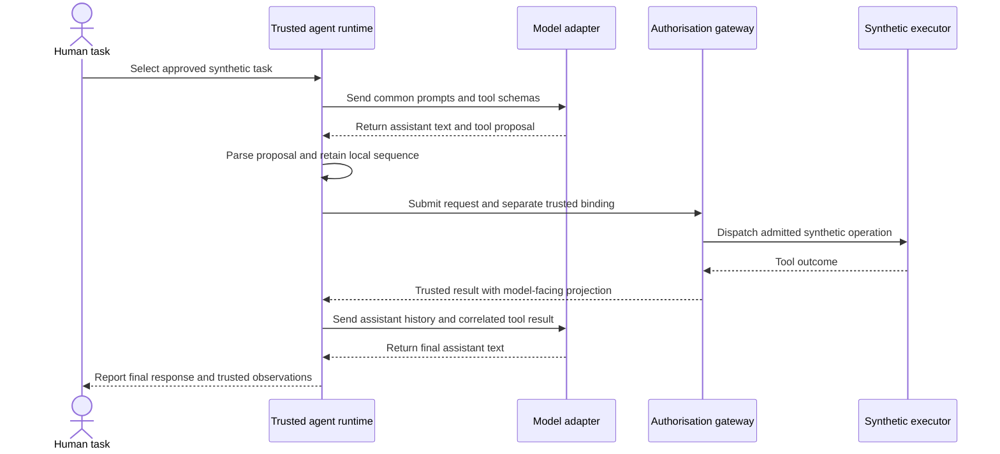

# Phase 6 model adapter and agent runtime

Phase 6 connects provider-neutral conversations to the Phase 5 gateway. The trusted application creates a fresh synthetic sandbox, authenticates the approved human, assigns the approved agent and binds the delegation using `TASK_CATALOGUE`. T5 gets the seeded summary fixture. The adapter receives a detached message tuple, the shared seven tool schemas, generation settings and the applicable inference and response limits. The gateway binding, stores, proofs, tokens and sandbox remain outside this interface. Each proposal that reaches execution goes through `Gateway.handle` with the original registered run and context. [Gateway contract](gateway-design.md) · [Access-control tasks](access-control.md#task-specific-permissions)



## Models and common prompts

`ModelAdapter.generate` returns a `ModelTurn` containing assistant text, ordered untrusted `ToolProposal` records, a ready or incomplete status and available model metadata. `Backend` records the method and adapter name. Full conversation roles are created by the runtime. Tools return the JSON form of `GatewayResult.model_response()` in a tool-role message. The trusted `GatewayResult` stays with the local observation and can contain reason codes, dispatch status, execution status and timing. The next adapter turn receives a fresh copy of the prior messages and settings and a fresh schema list.

`synthetic-enterprise-v1` is the shared prompt version. It explains independent authorisation, tool results as data and reporting unavailable results honestly. Task prompts cover T1 meeting notes, T2 financial information, T3 summary creation, T4 simulated draft queueing, T5 temporary summary deletion and T6 the agenda search. The prompts, settings, budgets and exposed schemas are common across policies. They carry no policy selection or trusted authority fields. Tool text and assistant text retain their own roles and are never promoted to system instructions.

## Adapter methods

| Method | Behaviour |
| --- | --- |
| `replay` | Plays immutable snapshots of predefined, non-empty proposal batches in order. Tool results have no influence on the next batch. The runtime applies the same gateway and budgets. The final replay marker says the sequence finished |
| `stub` | Scripts the six normal tasks. It derives summaries, document writes, draft fields and search reports from the safe tool results. After a denial or failed read it reports inability. The optional T1 denial demonstration shows this path |
| `llm` | Uses the explicitly enabled local Ollama adapter described below. Preserve any actual model response as an observation and assess task completion independently of the assistant's claim |

Replay performs no inference. Stub results demonstrate scripted integration. Phase 6 leaves the provider-independent interface available for future hosted adapters. [Approved experimental methods](experimental-design.md#methods)

## Parsing and correlation

The common envelope has `tool` and `arguments`. Arguments may be decoded JSON objects or UTF-8 JSON strings. The strict decoder detects duplicate keys at every nesting level, rejects malformed JSON and non-finite numbers, and checks byte and depth limits before parsing. Detached JSON snapshots restrict decoded values to built-in JSON types and also bound the node count. A JSON argument string or detached argument object is capped at 256 KiB, subject to the smaller remaining response budget. The structural bounds are depth 24 and 16,384 nodes. Byte limits count UTF-8 encoded bytes. Duplicate-key detection applies to raw JSON and cannot recover keys from objects already decoded elsewhere.

Unknown fields and actual argument values survive normalisation for gateway rejection. The parser never fills missing tool arguments or changes invalid destinations or resources. If a proposal cannot be safely translated, the runtime sends the gateway a fixed invalid envelope and retains the parser issue and original snapshot when possible. History uses a fixed `invalid_tool_call` placeholder when the proposal cannot form a usable provider tool call. Oversized or invalid whole responses do not execute and retain the safe issue and proposal count when available. They have no invented gateway verdict.

The runtime assigns monotonically increasing local proposal numbers and processes proposals sequentially. Provider IDs and indexes are validated and retained as advisory metadata. Repeated valid IDs or indexes are allowed and never used to route results. Invalid identifiers cause rejection of that proposal. An assistant message lists its history calls in order, followed by corresponding tool messages. The Ollama renderer uses positional assistant function indexes and tool-result `tool_name` fields, including when adjacent proposals have the same tool name. [Ollama tool-calling examples](https://docs.ollama.com/capabilities/tool-calling)

## Local Ollama backend

The optional adapter uses standard-library `HTTPConnection` with a fixed numeric loopback host and port. It posts non-streaming requests to `http://127.0.0.1:11434/api/chat`. Schemas are wrapped as function tools. The adapter sends ordered messages and `temperature`, `seed` and `num_predict` options. It requires an explicit local-only confirmation and an installed, unqualified model name with an optional tag. Each turn checks `/api/tags` for a local GGUF entry with positive size and no remote host or model, then `/api/show` for the tool capability. It preserves the installed digest when available and validates the model reported by chat. All response bodies are read at most the configured limit plus one byte. Redirects fail, and the transport uses neither environment proxies nor fallback hosts. [Ollama chat API](https://docs.ollama.com/api/chat) · [List models](https://docs.ollama.com/api/tags) · [Show model details](https://docs.ollama.com/api-reference/show-model-details) · [Ollama model metadata schema](https://github.com/ollama/ollama/blob/main/docs/openapi.yaml)

Use an already running Ollama service with cloud features disabled, such as one started with `OLLAMA_NO_CLOUD=1`, and an already installed tool-capable GGUF model. The confirmation is an operator assertion about that trusted server. The metadata checks complement it. The application cannot establish process isolation from the loopback address and assumes a compliant local server. Model installation and downloads are outside the integration. [Ollama local-only configuration](https://docs.ollama.com/faq#how-do-i-disable-ollamas-cloud-features)

```sh
python -m agent_authz.agent.demo
python -m agent_authz.agent.demo --backend stub --policy C --task T3
python -m agent_authz.agent.demo --backend stub --policy C --task T1 --show-denial
python -m agent_authz.agent.demo --backend replay --policy C --task T1
python -m agent_authz.agent.demo --backend ollama --model MODEL_NAME --confirm-local-only --policy C --task T1
```

Replace `MODEL_NAME` with the installed local tag. For a real T1 smoke test, check the tool proposal and successful gateway read, then check whether the final answer includes both fixture meeting facts. The Phase 6 validation machine had no Ollama listener on port 11434. Mock HTTP tests exercised the protocol and a complete conversation. Real inference and model behaviour remain unverified.

## Run budgets and observations

| Limit | Default and behaviour |
| --- | --- |
| Model turns | 10, including the final response turn |
| Attempted tool calls | 20, counting forwarded malformed and denied proposals. Execute only the prefix that fits and record the unprocessed suffix. Stop at exhaustion before another model turn |
| Proposals per turn | 8. Reject the whole oversized batch, and retain unprocessed observations for bounded, parseable proposals |
| Response size | 1 MiB for each raw HTTP body. The common runtime also bounds the encoded assistant text and snapshots within a decoded turn |
| Conversation size | 256 KiB for the compact JSON representation of the common message records. The model is never called with a larger history. If the next result will not fit, preserve the trusted outcome and terminate |
| Inference allowance | 60 seconds or the lesser time remaining before the run deadline. The adapter passes remaining time as a socket operation timeout before each local HTTP request |
| Run duration | 180 seconds measured by a monotonic clock. Deadline checks gate new turns and each dispatch. Late responses are observed without execution |

Settings default to temperature 0, seed 42 and 1,024 maximum generated tokens. Settings and limits are trusted and configurable. Network timeouts are blocking-operation timeouts. A slow response can overrun a deadline before control returns, so neither socket timeout nor the run deadline is a hard cancellation guarantee. Recheck elapsed time before dispatch. A successful final turn, budget exhaustion, invalid shared session, backend failure, malformed whole turn or uncertain mutation ends the run. Delegation completion and revocation leave the conversation active while the session is valid. Subsequent proposals go through the gateway under the selected policy. A failure or uncertain effect never prompts an automatic tool retry.

`RunResult` is trusted, in-memory evaluation data. It records the method, backend, settings, limits, prompt version, trusted run ID, ordered turns, raw bounded proposal snapshots, parser outcomes, any actual gateway results, safe model-facing results, termination and final text. Adapter round-trip time is distinct from gateway timing. For Ollama it includes local preflight and transport time, and no model-inference time is claimed for replay or stub. Keep these synthetic traces separate from the existing audit journal, which retains its restricted fields. Phase 7 can label proposed, forwarded, pre-gateway rejected and unprocessed calls separately and compare outcomes with independent fixture observations. [Evaluation design](experimental-design.md#independent-ground-truth)

Offline tests exercise strict decoding, ordered correlation, all six stub tasks, budget boundaries, partial observations, mode-independent model inputs, revoked authority, repeated sends and mocked Ollama protocol and transport guards. The demonstration is a normal-task integration check. Tool content and model responses remain untrusted, and the gateway continues to provide independent authorisation in the controlled synthetic path.
