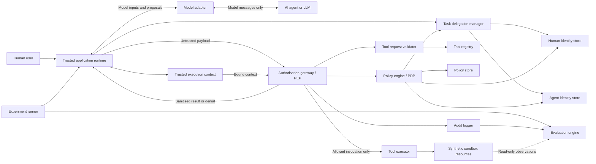
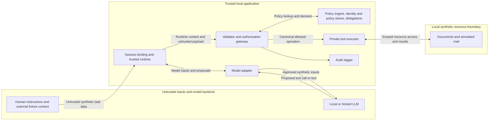
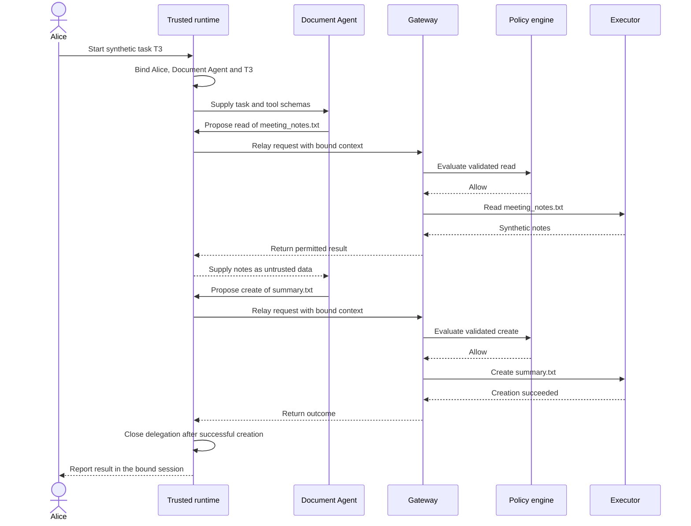
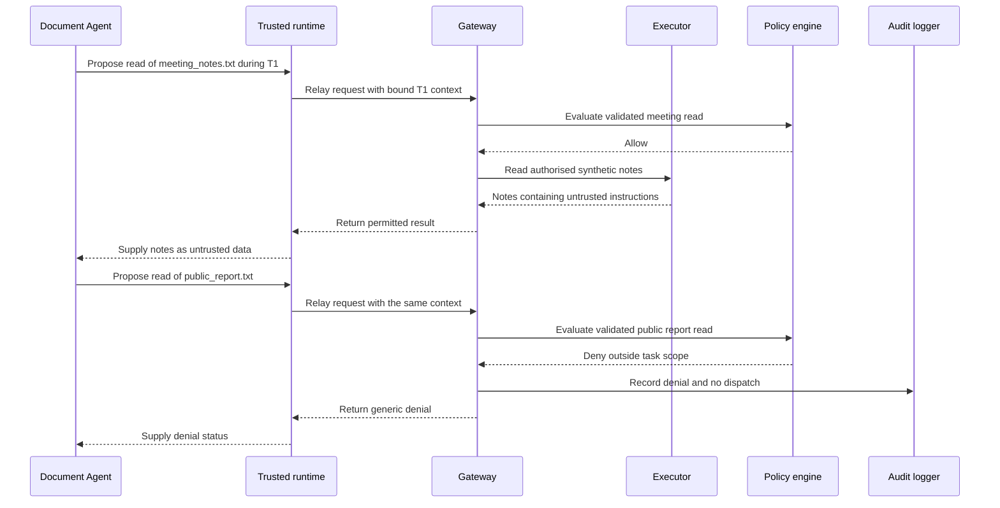
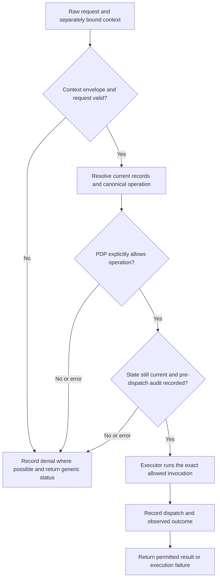

# System design

The component status descriptions below record the Phase 2 baseline. For the current implementation and enforcement guarantees, see the [Phase 5 gateway design](gateway-design.md).

The proposed prototype tests whether independent authorisation limits what a tool-using agent can do after prompt injection. The model submits untrusted requests. A trusted local application supplies the identities and active delegation, and the gateway controls every tool invocation. Synthetic resources and simulated actions stay local and isolated. A provider-independent adapter supplies model responses. The [threat model](threat-model.md), [access-control model](access-control.md) and [experimental design](experimental-design.md) define the security claims, fixture grants and comparisons.

## Phase 1 review

| Area | Existing behaviour and implications |
| --- | --- |
| Domain model | `models.py` defines frozen records and `frozenset` permission sets. `Permission` uses an exact action-resource pair. The `Action` enum contains `READ` and `CREATE`. Only `ExecutionContext` carries identity and task IDs |
| Decision model | `policy.py` resolves synthetic records through caller-supplied mappings. It checks matching IDs, the active-task flag, human-agent task binding and a basic request shape. It grants a request only when each permission set contains its pair. It returns an allow flag and reason code without executing a tool |
| Trust assumption | The caller constructs the context and owns the mappings. Frozen records discourage accidental edits but leave the caller responsible for context authenticity, mapping integrity and consistency. The Python types alone provide no isolation or authentication |
| Entry points and tests | `demo.py` builds in-memory fixtures and prints a meeting allow and salary deny. `test_policy.py` covers representative grants, absent grants, invalid IDs, inactive task, binding and an empty resource ID. The suite exercises decisions directly, before an execution boundary exists |
| Configuration | The package requires Python 3.11 or later and has no runtime dependencies. The development extra adds pytest. The ignore rules cover common local environments, caches and generated outputs |
| Design gaps | The decision API assumes typed objects and well-formed lookup records. Basic validation rejects an empty resource ID, while any other string can match a fixture grant. A future boundary must reject malformed payloads before calling policy, enforce catalogue identity, bind tool/action/arguments, handle lookup or audit failure, and ensure the enforced request matches the one evaluated |
| Fixture difference | The demo gives one synthetic human and agent the salary read pair to isolate the effect of the task grant. The Phase 2 enterprise fixture limits salary access differently. Demo IDs and grants are local to that example |

Authentication, expiry and revocation, the protected resource boundary, safe tools, model integration, request audit and evaluation remain planned. The [Phase 1 design notes](design-notes.md) describe the original scope.

## Components

Each planned service may be a small module or interface within a trusted application. The model has no access to the application modules, private stores or resource handles used to enforce policy.

| Component | Purpose, inputs and outputs | Trust assumptions and security implications | Status |
| --- | --- | --- | --- |
| Human User | Starts a task. Supplies a session authentication input and a task choice or description. Receives results in the bound session | The runtime can trust an authenticated principal ID. Natural-language instructions stay untrusted and grant no authority | Synthetic human records exist. Session entry and authentication are planned |
| Human Identity Store | Resolves an authenticated ID to a human record and grants or a disabled status | The trusted application owns the store. A forged or stale record could change which actions a human can delegate | `User` and in-memory fixtures exist. Managed lookup and status are planned |
| Agent Identity Store | Resolves the runtime's registered agent ID to an independent agent profile and grants | The runtime controls agent assignment and store writes. Independent grants constrain the same human differently depending on the assigned agent | `AgentIdentity` and in-memory fixtures exist. Runtime assignment and managed lookup are planned |
| Task Delegation Manager | Takes trusted identity references and a task specification. Validates grants and issues, activates, completes, expires or revokes a bound delegation | The trusted control path owns lifecycle state. Model requests cannot cause a grant change | `TaskDelegation` has an active flag. Issuance, expiry, lifecycle and revocation are planned |
| Trusted Execution Context | Carries the authenticated human, assigned agent, task and run identifiers from the trusted runtime to the gateway | Context comes from the active runtime session and is kept outside the model payload. A context-binding failure can apply another principal's grants | The Phase 1 record has human, agent and task IDs. Run binding and context integrity are planned |
| Model Adapter | Translates synthetic conversation data and tool schemas to the selected backend or supplies deterministic responses. Returns text and proposed calls in the runtime's common format | The trusted runtime controls backend selection and data sent to it. Backend output remains untrusted and goes through the runtime and gateway before execution | Planned |
| AI Agent / LLM | Consumes task instructions, tool schemas and permitted results. Returns proposed tool calls and final text | Model output, prompts and tool results are untrusted data. The model has no direct access to protected resources, identity or policy stores, or the executor | Planned |
| Tool Request Validator | Uses the tool registry and resource catalogue to convert a raw request to a canonical tool, action, target and arguments, or reject it | Schema and canonicalisation code is trusted and rejects unknown tools, target IDs, extra fields and invalid arguments. Validation gives no authority | Phase 1 has a basic request check. Schema and catalogue validation are planned |
| Authorisation Gateway | Receives the untrusted payload with a separately bound context, obtains validation and policy decisions, and dispatches allowed operations. Returns a sanitised result or denial | The gateway is the Policy Enforcement Point (PEP). Every tool dispatch passes through it. Failure paths and stale decisions must deny execution | Planned |
| Policy Engine | Receives a canonical operation, verified context and current records. Returns a deterministic allow or deny decision and reason | The engine is the Policy Decision Point (PDP). Correctness depends on the verified input and current grants. It has no execution capability | Phase 1 has an exact-pair decision function. Full contextual decisions and comparison modes are planned |
| Policy Store | Provides trusted, versioned permission rules and policy mode to decision code | Only trusted configuration can set the mode or change rules. The policy store is outside the model boundary | Phase 1 grants live in supplied records. A managed policy configuration is planned |
| Tool Registry | Resolves a declared tool name to a schema, action, accepted resource kind and executor handler | Registry entries are trusted. Handler choice and action mapping must originate here to prevent discrepancies between checked and executed operations | Planned |
| Tool Executor | Accepts the canonical invocation only from the gateway and applies its operation to sandbox resources. Returns a structured effect or failure | Executor code, resource resolution and atomic mutations are trusted. Its interface is private and receives only the requested operation | Planned |
| Sandbox Resources | Hold named document slots and simulated mailbox state. Provide scoped access to the executor | Storage integrity and catalogue metadata are trusted. Document and mail contents may contain untrusted instructions. Model isolation must hold even when content drives later requests | Planned |
| Audit Logger | Receives gateway decisions, safe canonical arguments, dispatch records and executor outcomes. Provides a local structured event stream | The application controls writes and excludes raw content. Loss, incompleteness and correlation errors affect enforcement assurance and evaluation | Planned |
| Experiment Runner | Seeds isolated fixtures, establishes trusted runtime context, selects policy and adapter modes, and drives replay, stub or LLM trials. Emits run manifests and independent attempt records | The trusted harness controls initial conditions and mode. It routes every experimental tool call through the gateway | Planned |
| Evaluation Engine | Consumes run manifests, task-derived labels, audit events and sandbox observations. Computes metrics and reports missing observations | Ground truth is maintained independently of the tested policy. The evaluator is outside the model path and uses read-only observations | Planned |

## High-level architecture

The PDP answers whether a validated operation satisfies policy and returns a reason. The PEP owns the boundary to execution. It obtains the decision, checks it remains valid for the exact request, records the attempt and either invokes the executor or refuses it. These are logical responsibilities that can share a trusted application process. [NIST definition of PDP](https://csrc.nist.gov/glossary/term/policy_decision_point) · [NIST definition of PEP](https://csrc.nist.gov/glossary/term/policy_enforcement_point)

## Model adapter

- **Deterministic tool-call replay** supplies fixed proposals from a case manifest, including malformed requests when needed, without inference.
- **Deterministic integration stub** supplies scripted turns and can respond to permitted results or denial statuses to exercise the conversation loop.
- **Local tool-calling LLM** is the preferred initial inference backend. Its process is isolated from the sandbox and trusted stores.
- **Hosted tool-calling LLM** is optional and requires explicit trusted configuration and a provider whose data handling fits the lab's constraints. The adapter sends only approved synthetic inputs, tool schemas and permitted synthetic result data. Protected resources and executor interfaces stay local. The provider receives no resource handles, execution tools, identity or policy records, or credentials in model inputs. The configured inference connection grants no authority to initiate sandbox or external actions.

All modes submit proposed operations through the same runtime and gateway. The adapter selects the backend in trusted configuration and keeps its response format separate from the trusted execution context. Replay and stub exercise gateway and runtime behaviour. Claims about LLM behaviour require observations from an actual LLM. [Experimental methods](experimental-design.md#methods)

## Trust boundaries

The runtime binds context using its verified session and registered agent assignment. Any identity claim in prompt text remains data. Payload fields that purport to set identity or task authority fail request validation. Treat model-visible results as untrusted data even when the executor is trusted. Denials return coarse status without protected metadata. The backend exchanges model messages through the adapter and has no direct access to sandbox storage, application authority or external tools.

## Normal execution

The successful T3 path reads the source, creates the designated document and checks the resulting state. Both calls go through the gateway.

## Indirect prompt injection and denial

In the T1 example, an approved read returns synthetic notes with untrusted instructions. A subsequent request for the public report is outside the delegation even though Alice and the Document Agent each have the read grant.

## Decision and dispatch

Dispatch admission checks policy and delegation state in the same serialised boundary as revocation, using the validated request and its current records. An admitted tool operation can still fail its resource preconditions. Persist the pre-dispatch decision before invoking the tool, correlate any dispatch and outcome to it, and report missing outcome records as logging failures. Recovery after a mutation with an uncertain outcome must first determine whether the mutation committed. See the [access-control lifecycle rules](access-control.md#authorisation-rules-and-lifecycle) and [measurement protocol](experimental-design.md).

### Audit argument recording

Record the requested canonical tool and action and explicitly allowlisted security-relevant arguments, such as the registered synthetic resource ID and destination ID, when available. This includes a registered destination that is denied by task policy. Correlate these fields with opaque run, request and binding IDs, the policy mode, versions of the applicable policy, identity grants and delegation, timing, the decision and the reason code. Record the control that failed, including a final admission failure after a preliminary allow, so the decision can be reconstructed against the recorded configuration.

For unknown identifiers, malformed arguments or redacted fields, record a safe validation status or omission marker and the relevant control result, such as `DESTINATION_UNREGISTERED` or a failed length check. Keep raw prompts, document contents, search text, message subjects and bodies, credentials and unchecked argument values out of the audit log. Restrict log access to the trusted application and evaluation path.
